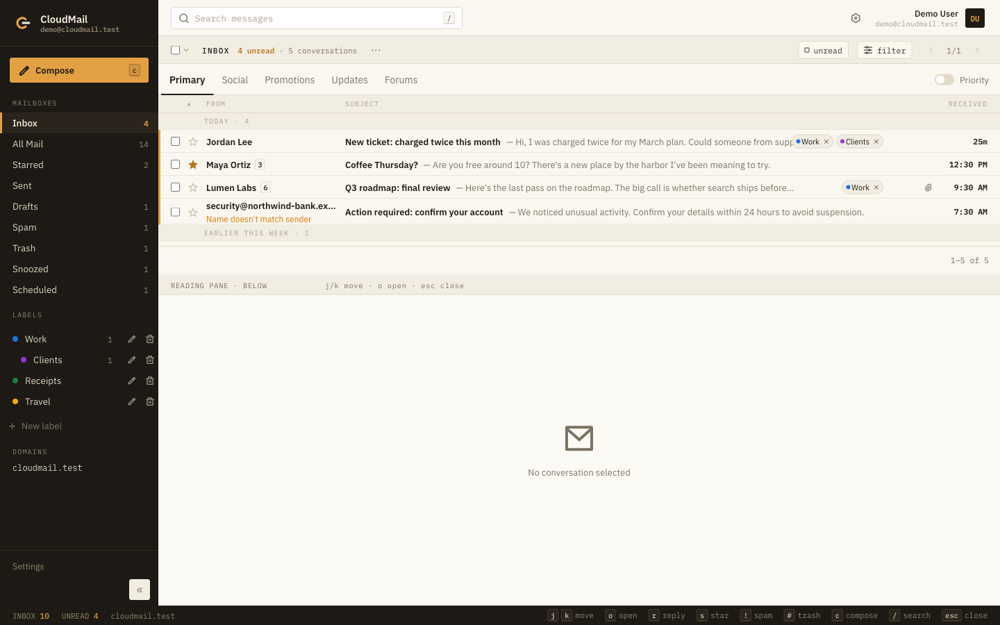
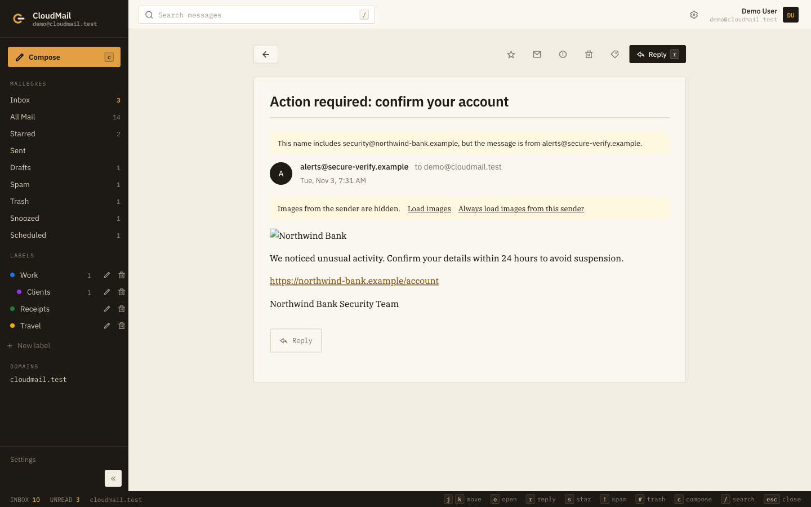
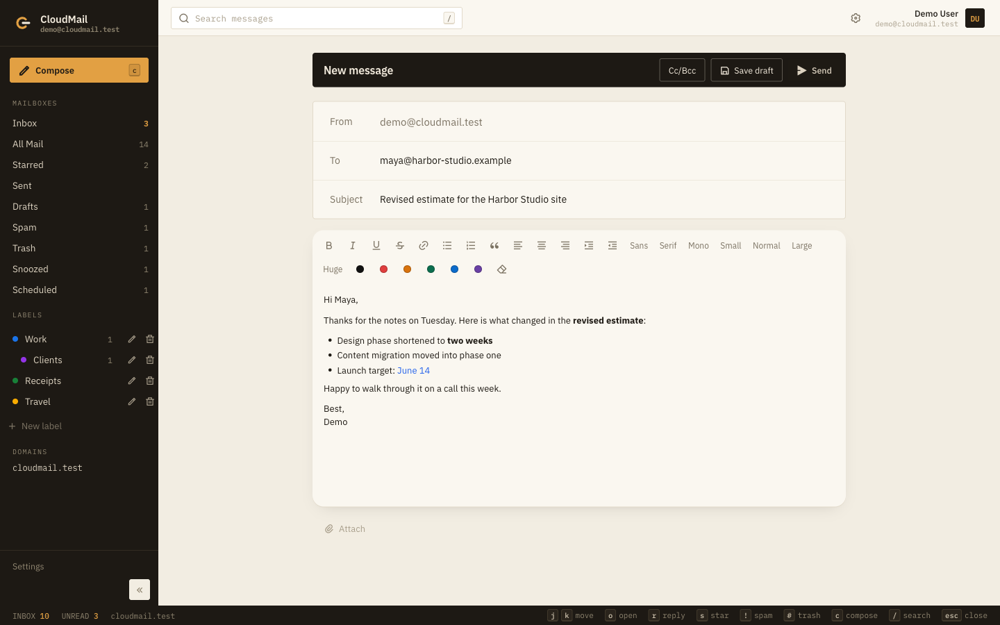
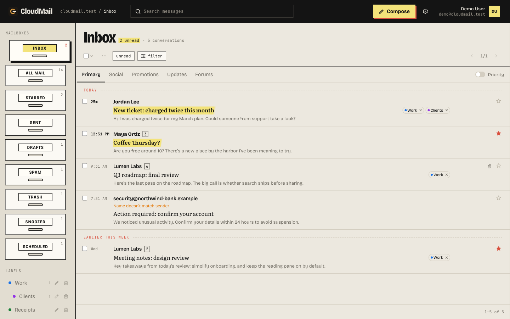
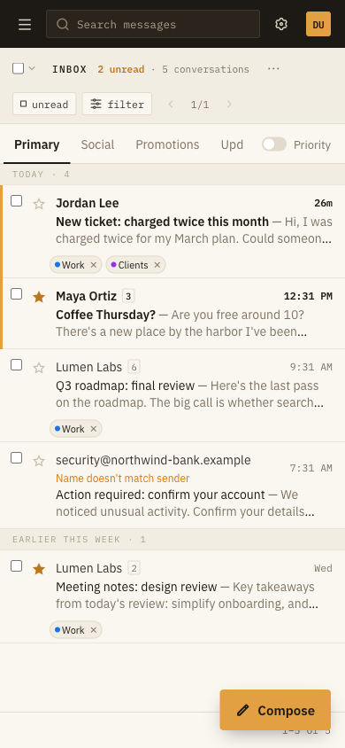

# CloudMail

A self-hosted webmail client for your own domain, running on Cloudflare Workers.
Mail comes in and goes out through Resend or Cloudflare Email Service. Messages
live in D1 and attachments in R2. There is no third-party mailbox, and every
address is `you@yourdomain.com`.

Licensed under [Apache-2.0](LICENSE). CloudMail started as a fork of
[QuickMail](https://github.com/DivinPrince) by Irasubiza Divin Prince (MIT). See
[NOTICE](NOTICE).



## Features

For a full tour with screenshots of every screen, see **[docs/FEATURES.md](docs/FEATURES.md)**.

| Reading safety | Composer |
|---|---|
|  |  |
| **The Notes look (one of four)** | **On a phone** |
|  |  |

**Reading**

- Threaded conversations with collapsible quoted history
- Split view or a full-page reader, with the reading pane to the right, below, or off
- Markdown bodies and `.md` attachments are rendered
- Four looks, saved per account: **Ledger** (dense and keyboard-first, the default), **Desk**, **Notes**, and **Classic** (a Gmail-style layout with light and dark modes)
- Keyboard shortcuts: `j`/`k`, `o`, `r`, `s`, `!`, `#`, `x`, `c`, `/`

**Writing**

- Rich-text composer with fonts, lists, alignment, and image resizing
- Reply, reply all, and forward with the original quoted. Replies go out from the address the mail arrived at, including catch-all addresses, and honour `Reply-To`
- Undo send (5, 10, 20, or 30 seconds) and scheduled send, with a Scheduled mailbox
- Draft autosave
- A signature per address, swapped automatically when you change From

**Organizing**

- Inbox categories: Primary, Social, Promotions, Updates, Forums
- Archive, snooze, mute, star, spam, and trash a whole conversation, with undo
- Nested labels, up to five levels deep
- Filters that file new mail and can be applied to mail you already have
- Blocked senders and one-click unsubscribe through the `List-Unsubscribe` header

**Safety**

- Received HTML renders in a sandboxed iframe
- Remote images are held until you load them or trust the sender
- A warning before a link opens when its text and target hosts disagree
- A banner when a display name claims a different address than the real sender
- Optional VirusTotal scanning of incoming attachments. A file stays locked until its scan comes back clean, and you set the detection threshold
- Only images, PDFs, and plain text open in the browser. HTML, SVG, and other active files always download

**Accounts**

- Multiple domains and multiple users. Each user has their own addresses and a default sending identity
- Role addresses such as `postmaster@`, `abuse@`, and `billing@` can only be handed out by an admin
- Sign-in is rate limited over 15 minutes: 20 tries per account across all IPs, 10 from any one IP (IPv6 counted per /64), and 20 per IP overall. Browsers that have signed in before keep their own count, so a flood of wrong passwords can't lock the owner out
- Admins get a domain catch-all and a view of unrouted mail
- Delivery status (delivered, bounced, complained) via Resend webhooks

---

# Choose a mail provider

Each deploy uses one provider. Set `EMAIL_PROVIDER` to `resend` (the default) or
`cloudflare`, and don't point a domain's apex MX at both.

| | [Resend](https://resend.com) | [Cloudflare Email Service](https://developers.cloudflare.com/email-service/) |
|---|---|---|
| Outbound | `POST https://api.resend.com/emails` | Workers `env.EMAIL.send()` |
| Inbound | Webhook → `/api/webhooks/resend` | Worker `email()` handler |
| DNS | Records Resend gives you (any DNS host) | **Cloudflare DNS required** |
| Cost | Resend free tier + Cloudflare | Email Sending needs a **Workers paid** plan. Routing is free. |
| Delivery events | Webhooks (`delivered`, `bounced`, …) | Accepted send is stored as `sent` |
| Best if | You already use Resend, or the domain is not on Cloudflare DNS | The zone is already on Cloudflare and you want mail on the same account |

Resend webhooks carry **metadata only**. On `email.received`, the app fetches
the body and attachments from Resend. Cloudflare delivers the full MIME on
`message.raw`, so no second fetch is needed.

---

# Setup

Plan on about 30 minutes, most of it waiting on DNS.

**You need**

1. A domain you control.
2. A [Cloudflare](https://dash.cloudflare.com) account.
3. Either a [Resend](https://resend.com) account, **or** the domain on Cloudflare DNS plus a Workers paid plan (for Cloudflare Email Sending).

## 1. Install

```bash
bun install          # or: npm install
bunx wrangler login
```

Cloudflare Email Sending needs **Wrangler 4.123 or newer**. Older versions call
the outdated `/email/sending/enable` path and get a 404. Check your version with
`bunx wrangler --version`, and upgrade with `bun add -d wrangler@latest`.

## 2. Create D1 and R2

```bash
bunx wrangler d1 create cloudmail
bunx wrangler r2 bucket create cloudmail-attachments
```

`d1 create` prints a `database_id`. In `wrangler.jsonc`, replace
`REPLACE_WITH_YOUR_D1_DATABASE_ID` with it.

Set `"name"` to whatever you want the Worker to be called. To serve CloudMail
from your own hostname, add a `routes` block. The zone has to be on the same
Cloudflare account.

```bash
bun run db:migrate:remote
```

Then follow **exactly one** of the two provider tracks below.

> Keep your real config out of git. Copy `wrangler.jsonc` to
> `wrangler.<name>.jsonc` (that pattern is gitignored), put your real id and
> routes there, and deploy with `bunx wrangler deploy -c wrangler.<name>.jsonc`.

---

## Track A — Resend

You can leave `EMAIL_PROVIDER` unset or set it to `resend`.

### A1. Verify the domain

In Resend, go to **Domains → Add Domain** and add every record it shows,
including the apex `MX`. Without that MX, mail never arrives.

| Record | Purpose |
|---|---|
| `TXT` on `resend._domainkey` | DKIM |
| `TXT` + `MX` on `send` | SPF and bounces |
| **`MX` on the apex** | **Receiving** |

Add a DMARC record on `_dmarc` while you test:

```txt
v=DMARC1; p=none; rua=mailto:you@yourdomain.com; pct=100; adkim=s; aspf=s
```

Start at `p=none` and tighten it to `p=quarantine` once mail flows. Enable
**sending and receiving** on the domain, then create an API key with full access
(send, domains, and receiving).

```bash
bunx wrangler secret put RESEND_API_KEY     # paste the re_... key
```

### A2. Deploy, then create the webhook

The webhook URL has to be public, so deploy first:

```bash
bun run deploy
```

Then in the Resend dashboard, open [Webhooks](https://resend.com/webhooks) →
**Add Webhook**:

- **URL**: `https://<your-worker-url>/api/webhooks/resend`
- **Events**: `email.received`, `email.sent`, `email.delivered`, `email.bounced`,
  `email.complained`, `email.delivery_delayed`, `email.failed`

Or create it with the API:

```bash
curl -X POST https://api.resend.com/webhooks \
  -H "Authorization: Bearer $RESEND_API_KEY" \
  -H "Content-Type: application/json" \
  -d '{"endpoint":"https://<your-worker-url>/api/webhooks/resend",
       "events":["email.received","email.sent","email.delivered","email.bounced","email.complained","email.delivery_delayed","email.failed"]}'
```

The response includes a `signing_secret`, and Resend **shows it only once**. Save
it as a secret and redeploy:

```bash
bunx wrangler secret put RESEND_WEBHOOK_SECRET   # the whsec_... value
bun run deploy
```

Then skip ahead to [First run](#first-run).

---

## Track B — Cloudflare Email Service

This track uses the [Email Service](https://developers.cloudflare.com/email-service/)
Workers binding (`env.EMAIL.send()`) together with Email Routing. The zone must
use **Cloudflare DNS**.

### B1. Enable sending and routing

In the dashboard (the most reliable route):

1. [Email Sending](https://dash.cloudflare.com/?to=/:account/email-service/sending) → **Onboard Domain** → your zone. Cloudflare adds the `cf-bounce` MX, SPF, DKIM, and `_dmarc` records.
2. [Email Routing](https://dash.cloudflare.com/?to=/:account/email-service/routing) → **Onboard Domain** on the same zone. The apex MX must point at Cloudflare (`route1.mx.cloudflare.net`, …).

Or with the CLI (Wrangler **4.123 or newer**):

```bash
bunx wrangler email sending enable yourdomain.com
bunx wrangler email routing enable yourdomain.com
```

To confirm:

```bash
bunx wrangler email sending list
bunx wrangler email routing settings yourdomain.com
```

Sending should show `enabled: yes`. Routing should show `Enabled: true` and
`Status: ready`.

### B2. Route all inbound mail to this Worker

Users can create any mailbox (`you@`, `billing@`, …). Email Routing allows only
200 named rules and knows nothing about D1, so you need a **catch-all that sends
to the Worker**. The CLI can only set the catch-all to `forward` or `drop`, so
use the dashboard:

1. Open [Email Routing](https://dash.cloudflare.com/?to=/:account/email-service/routing) for the domain.
2. Enable **Catch-all**.
3. Set the action to **Send to a Worker**.
4. Choose this Worker (`cloudmail`, or the `"name"` in your config).
5. Save.

The dashboard may ask for one verified personal destination before it saves any
rules. Verify one if it asks, but do **not** forward production mail there.

### B3. Point the Worker at Cloudflare Email

In `wrangler.jsonc`:

```jsonc
"vars": {
  "EMAIL_PROVIDER": "cloudflare",
  "CLOUDFLARE_MAIL_DOMAINS": "yourdomain.com"
}
```

If you onboard more than one domain, list them all, separated by commas.

```bash
bun run deploy
```

This track doesn't use a Resend key or webhook. `vite dev` never runs the
`email()` handler, so inbound mail only works on a **deployed** Worker or under
`bun run preview`.

---

## First run

1. Open the deployed URL, or `http://localhost:5173` after `bun run dev`.
2. Go to `/setup`, choose a domain the provider can see, and create the admin
   (name, local-part, password). That address is both the inbox and the login.
   If the Worker is on a public URL, set `SETUP_TOKEN` first (see
   [Optional settings](#optional-settings)) so nobody else can get there before you.
3. Other users sign up through `/onboarding` and claim an address on a connected domain.

Send yourself a message from another account. It should arrive within a few seconds.

## Upgrading

After pulling a new version, apply any new migrations, then deploy:

```bash
bun run db:migrate:remote
bun run deploy
```

## Optional settings

| Setting | Where | What it does |
|---|---|---|
| `ANTHROPIC_API_KEY` | `wrangler secret put` | Turns agents on. Agents read threads and propose replies, labels and notes through Claude; each has a monthly budget on the Staff page. Without a key, agents don't run and their work waits. |
| `VIRUSTOTAL_API_KEY` | `wrangler secret put` | Scans incoming attachments. A free key works: the once-a-minute cron stays within the public rate limit. Without a key, attachments are not scanned and stay downloadable. |
| `PATH_REDIRECT_FROM` / `PATH_REDIRECT_TO` | `vars` | Redirects a path on another host to the mail host. For example, `example.com/mail` → `mail.example.com`. |
| `SETUP_TOKEN` | `wrangler secret put` | **Recommended for public URLs.** Until the first admin exists, whoever opens `/setup` can create the admin account. With this set, setup also asks for the token. |
| `DEMO_MODE` | dev server environment | `"true"` runs a read-only demo with sample data. Set it on the command, not in `.dev.vars`. See below. |

The Worker runs a cron every minute (`* * * * *`). It sends any scheduled mail
that is due and scans pending attachments.

---

# Development

```bash
cp .dev.vars.example .dev.vars    # fill in the provider you are using
bun install
bun run db:migrate:local
bun run dev                       # D1 and R2 via platformProxy, secrets from .dev.vars
```

```bash
bun run test         # unit tests (bun test)
bun run check        # svelte-check
bun run check:clean  # make sure no secrets or live config are tracked
bun run preview      # production build + wrangler dev (needed for Cloudflare inbound)
bun run deploy       # build, wrap the Worker with email(), ship
```

`bun run build` runs SvelteKit and then `scripts/wrap-cloudflare-worker.mjs`.
The adapter writes a Worker that only handles `fetch`, and the wrap step adds
the `email()` and `scheduled()` handlers from `src/worker.ts`.

## Demo mode

Set `DEMO_MODE=true` on the dev command to explore the UI without a provider or
secrets:

```bash
DEMO_MODE=true bun run dev
```

Demo mode reads `DEMO_MODE` from the dev server's process environment. A value in
`.dev.vars` only reaches the Worker bindings, so it doesn't turn demo mode on.

You are signed in as `demo@cloudmail.test`, a non-admin user, with a mailbox of
sample threads. Demo mode is read-only: write requests are refused, and no mail
is sent. It can only be turned on from the server environment, never from a URL.

## Testing inbound mail

**Resend.** Webhooks can't reach `localhost`, so expose it through a tunnel:

```bash
cloudflared tunnel --url http://localhost:5173
```

Point a **second, throwaway** webhook at the tunnel. Don't repoint the
production webhook, or mail stops arriving as soon as the tunnel closes.

**Cloudflare Email.** Use `bun run preview` or a real deploy. The catch-all must
send to this Worker.

If you forget the admin password:

```bash
bun scripts/reset-admin-password.mjs you@example.com newpassword --local
```

Drop `--local` to reset it in production, and add `--config wrangler.<name>.jsonc`
if your live settings are in their own file. A reset signs that user out
everywhere, and browsers trusted under the old password stop counting as trusted.

## How inbound mail is routed

Both providers accept mail for every local-part on a connected domain. CloudMail
then decides who gets it:

1. If the address matches a row in `addresses` exactly, it goes to that user.
2. Otherwise it goes to the domain's **catch-all owner**, set in Admin.
3. Otherwise it is stored in `unrouted_emails` and listed in Admin.

Next, the message gets an inbox category, filters and blocked senders are
applied, and it is filed.

## Layout

```
src/
  worker.ts          SvelteKit fetch + email() inbound + scheduled() cron
  routes/            mailboxes, compose, settings, admin, setup, API
  lib/
    components/      sidebar, mailbox, composer, thread view
    organizing/      categories, filters, labels, snooze, unsubscribe
    writing/         composer, quoting, signatures, undo and scheduled send
    security/        image holds, link and sender checks
    skins/           Ledger, Desk, Notes, Classic
    server/          providers, inbound, D1 stores, auth, VirusTotal
scripts/
  wrap-cloudflare-worker.mjs   attach email() and scheduled() after the build
  check-template-clean.mjs     refuse to ship secrets or live config
migrations/          D1 schema, applied in order
tests/               bun test suites
```

## Troubleshooting

**`wrangler email sending enable` returns a 404.** Your Wrangler is too old.
Upgrade to 4.123 or newer, or onboard in the dashboard under **Compute → Email
Service → Email Sending**.

**The CLI won't set the catch-all to a Worker.** That's expected: the CLI only
supports `forward` and `drop`. Use the dashboard (step B2).

**Mail sends but never arrives (Resend).** Check that `dig MX yourdomain.com`
points at Resend and that receiving is enabled on the domain.

**Mail sends but never arrives (Cloudflare).** Check that the apex MX points at
Cloudflare Routing, the catch-all sends to this Worker, `EMAIL_PROVIDER` is
`cloudflare`, and the Worker is deployed. `vite dev` doesn't receive mail.

**Webhook returns 401.** `RESEND_WEBHOOK_SECRET` doesn't match. Resend shows the
secret only once, so delete the webhook and create a new one.

**Webhook returns 500.** Run `bunx wrangler tail` to see the error.

**Attachments are missing.** Check that the R2 bucket exists and that
`bucket_name` in your wrangler config matches its name.

**`database_id` errors on deploy.** Paste the id printed by `wrangler d1 create`
into your wrangler config.

**Setup shows no Cloudflare domains.** Set `CLOUDFLARE_MAIL_DOMAINS` and
`EMAIL_PROVIDER=cloudflare`, then restart the dev server.

---

## Security

To report a vulnerability, see [SECURITY.md](SECURITY.md).

## License

Copyright 2026 Sada Kshirsagar. Licensed under the [Apache License 2.0](LICENSE).

CloudMail is derived from QuickMail, Copyright (c) 2026 Irasubiza Divin Prince,
which was released under the MIT License. The original notice is kept in
[NOTICE](NOTICE).
