# CloudMail features

A tour of what CloudMail does, with screenshots taken in [demo mode](../README.md#demo-mode).
Every sender, address, and company in the screenshots is fictional.

- [Inbox](#inbox)
- [Reading a conversation](#reading-a-conversation)
- [Reading safety](#reading-safety)
- [Writing](#writing)
- [Organizing](#organizing)
- [Four looks](#four-looks)
- [Settings](#settings)
- [Phones](#phones)
- [Accounts and domains](#accounts-and-domains)

---

## Inbox

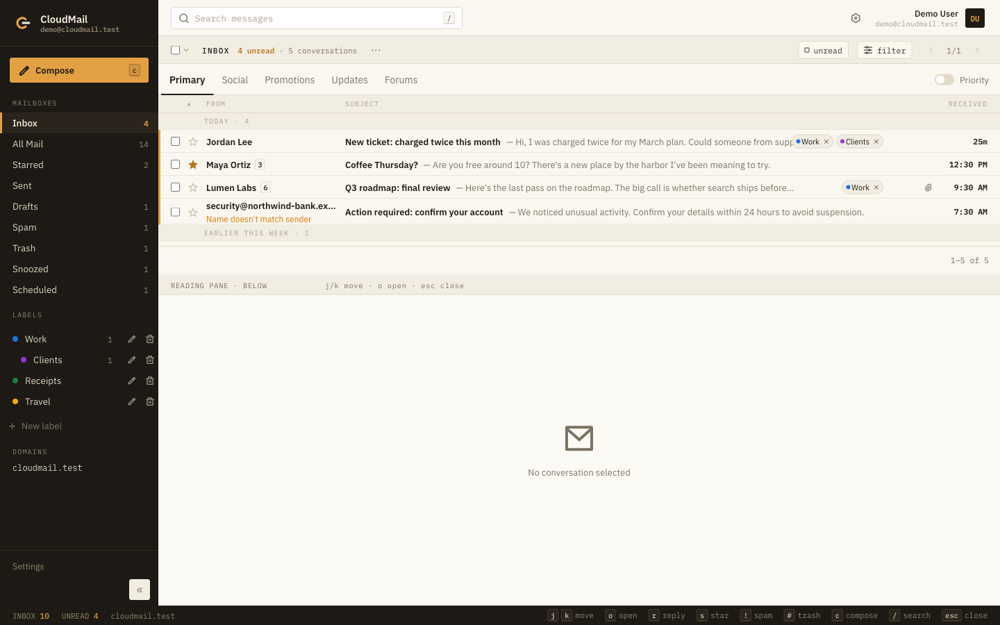

- **Threads.** Replies are grouped into conversations, and the number next to the
  sender is how many messages the conversation holds.
- **Category tabs.** New mail is sorted into Primary, Social, Promotions,
  Updates, and Forums based on its headers. Mailing-list replies go to Forums,
  bulk mail with an unsubscribe header to Promotions, and automated or
  `noreply` senders to Updates. A filter can override the category.
- **Labels in the list.** Labels appear on each row and can be removed right
  there. Nested labels, such as Work › Clients, are shown in the sidebar.
- **Keyboard first.** `j`/`k` move, `o` opens, `r` replies, `s` stars, `!`
  marks spam, `#` trashes, `x` selects, `c` composes, and `/` searches. The bar
  at the bottom lists the shortcuts.
- **Search and quick filters.** Search covers subject, preview, and sender. You
  can narrow to unread, starred, or messages with attachments.
- **Priority** sorts important and unread conversations to the top.

## Reading a conversation

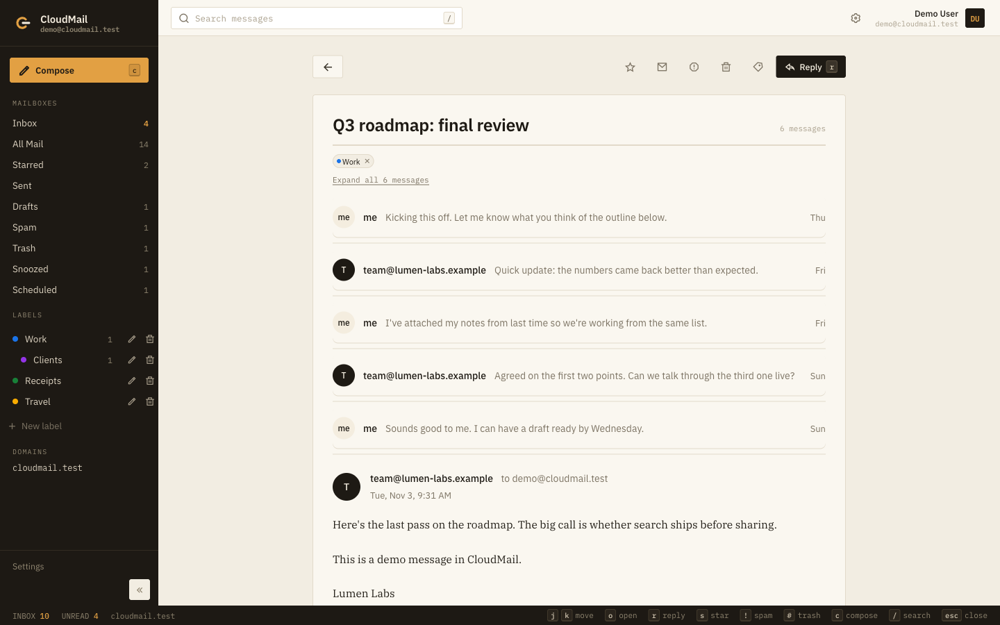

- Older messages collapse to one line each, and **Expand all** opens them.
- Quoted history inside a message collapses, so you read only what's new.
- Markdown bodies and `.md` attachments are rendered. ASCII tables keep their
  shape on phones.
- **Reading pane.** Open a conversation in a split view (to the right of the
  list or below it) or on its own page. You choose which in Settings.

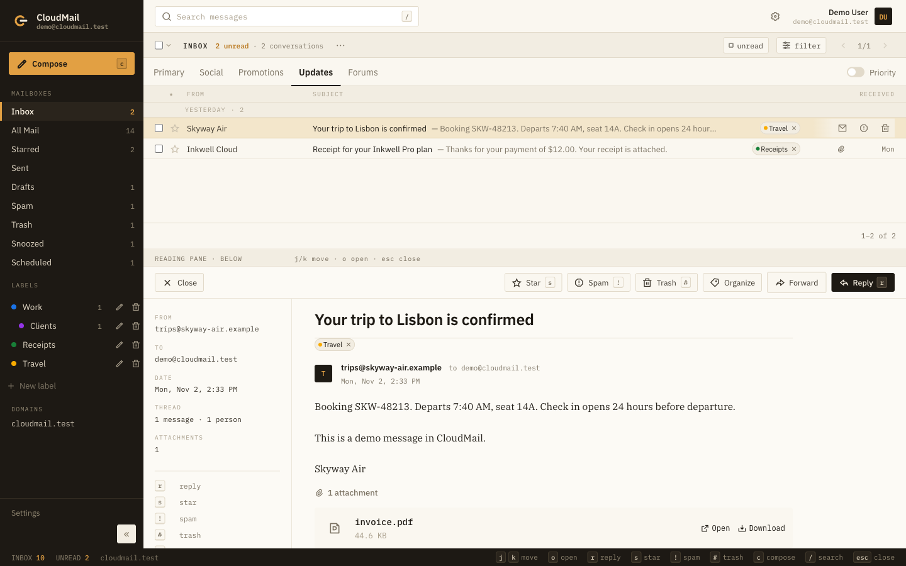

## Reading safety

Received mail never runs in the app itself. HTML is shown in a sandboxed frame
with scripts disabled, and the app sends a strict Content-Security-Policy. When
you reply or forward, the quoted copy is sanitized and the sender's remote
images stay held unless you trust them. On top of that:

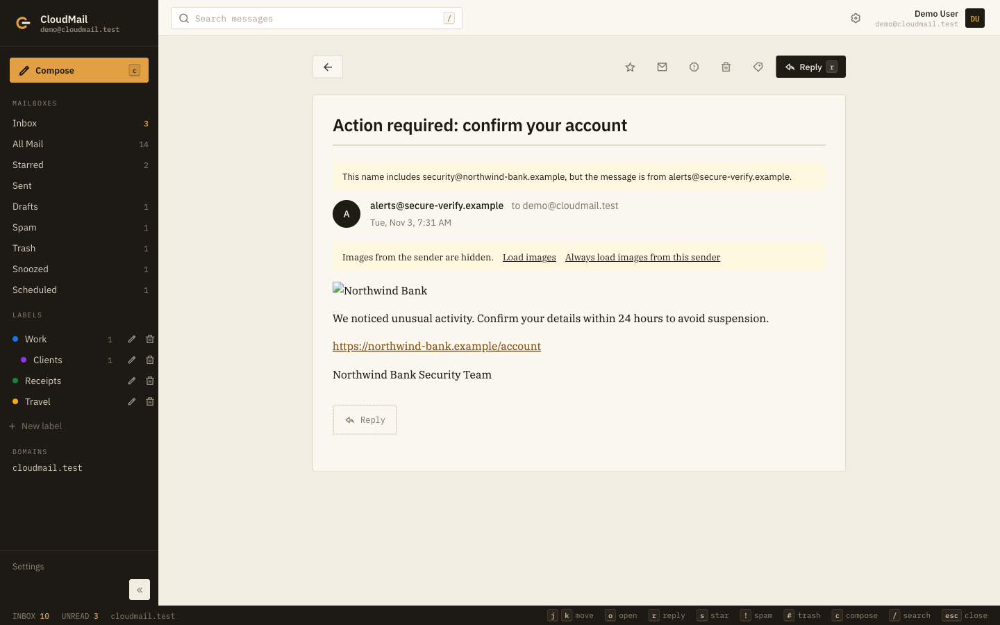

- **Look-alike senders.** When a display name contains a different address or
  domain than the real sender, a banner says so. The list view flags the row
  with *Name doesn't match sender*.
- **Remote images are held.** Tracking pixels and remote images don't load until
  you choose **Load images**. You can also trust a sender, so their images
  always load.
- **Link checks.** When a link's text names one site but points to another,
  CloudMail asks before opening it:

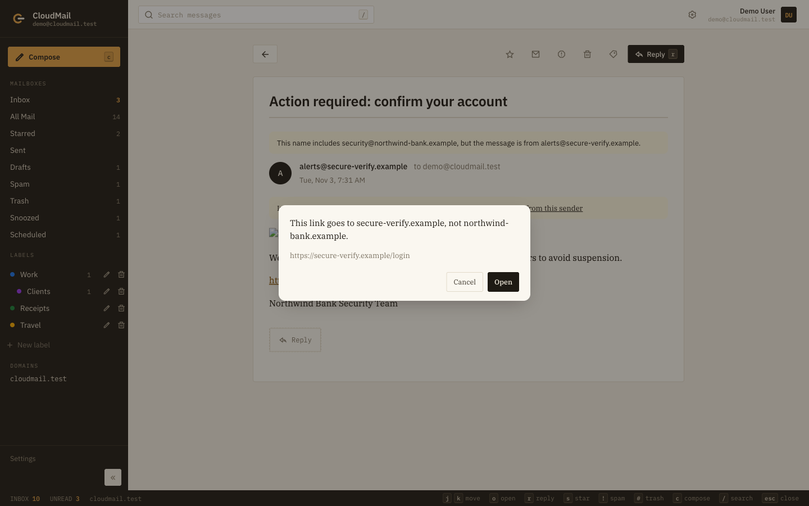

- **Attachment scanning (optional).** With a VirusTotal API key set, incoming
  attachments are scanned in the background. A file can't be opened until its
  scan is clean, and you choose how many engines must flag it before it's
  blocked. Only images, PDFs, and plain text open in the browser. Everything
  else downloads.

## Writing

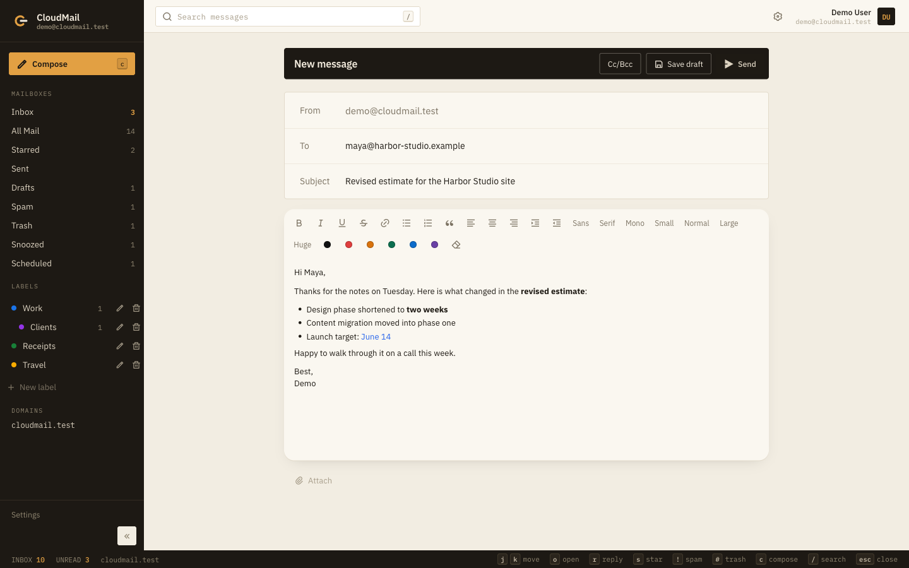

- **Rich text:** bold, italic, underline, strike, links, lists, quotes,
  alignment, indent, fonts, sizes, and colours. Pasted images can be resized.
- **Reply, reply all, and forward.** The original message is quoted below your
  reply. Replies go out from the address the mail was sent to, including
  catch-all addresses, and follow the sender's `Reply-To`.
- **Undo send.** Messages wait 5, 10, 20, or 30 seconds before they go out, so
  you can take them back.
- **Scheduled send.** Pick a time and the message waits in **Scheduled**. A
  cron job on the Worker sends it even if your browser is closed.
- **Drafts autosave** while you type.
- **Signatures per address.** When you change the From address, an unedited
  signature is swapped for that address's signature.

## Organizing

- **Archive, snooze, mute, star, spam, and trash** act on a whole
  conversation, and each can be undone. Snoozed mail comes back to the inbox at
  the time you pick.
- **Labels** can be nested up to five levels deep, with eight colours.
  CloudMail rejects duplicate names and cycles.
- **Filters** match on from, to, subject, words, or attachments. A filter can
  apply a label, skip the inbox, star, mark important, mark read, set the
  category, forward, or trash matching mail. It runs on new mail and, once you
  confirm, on mail you already have.
- **Blocked senders** go straight to Spam.
- **Unsubscribe** uses the message's `List-Unsubscribe` header. Requests to
  private network addresses are refused.

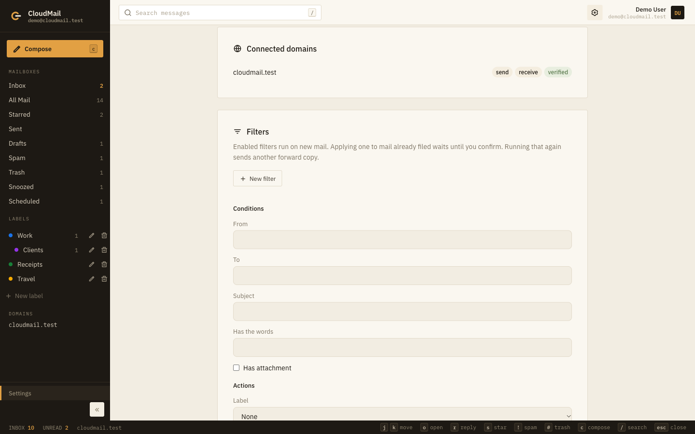

## Four looks

Each user picks a look in Settings. The choice is saved to the account, so it
follows you across devices.

| Ledger (default) | Desk |
|---|---|
|  | 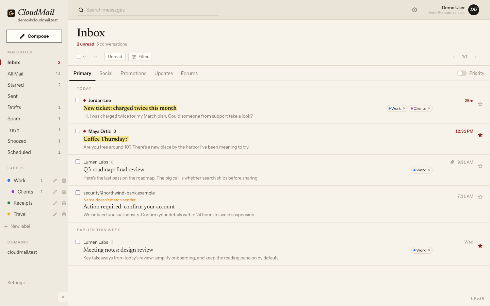 |
| **Notes** | **Classic** |
| 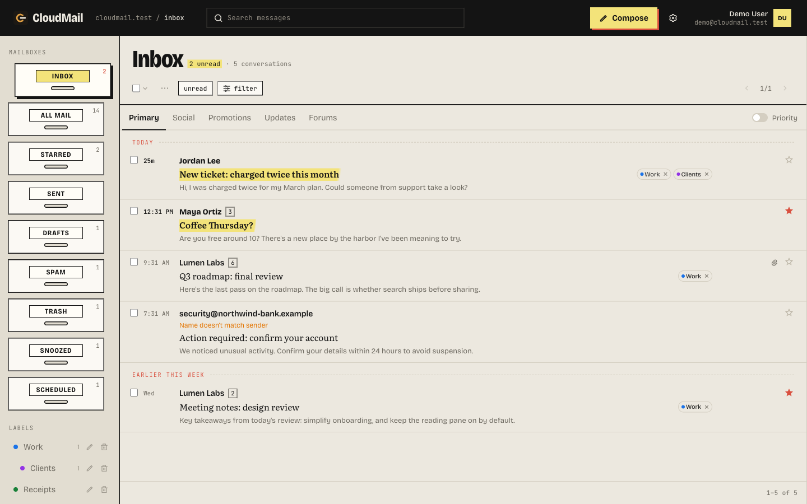 | 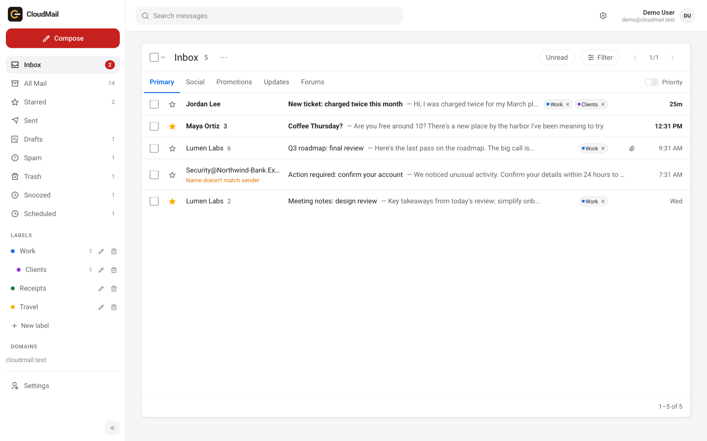 |

- **Ledger:** dense, one line per message, keyboard first.
- **Desk:** a quiet paper desk where messages read like letters.
- **Notes:** bold bars, folder drawers, and highlighted unread mail.
- **Classic:** a familiar webmail layout with light and dark modes.

## Settings

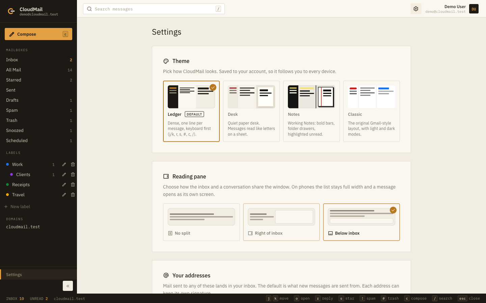

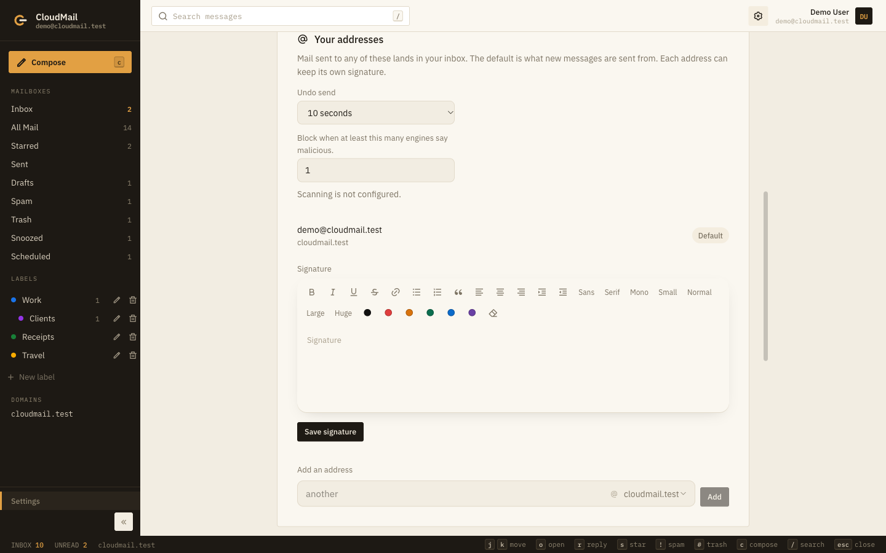

- Look and reading pane
- Undo-send delay and the attachment-scan threshold
- Your addresses, the default From address, and a signature for each address
- Connected domains
- Filters, blocked senders, and trusted image senders

## Phones

The layout adapts to small screens. The list stays full width and a
conversation opens as its own screen.

| Inbox | Conversation |
|---|---|
| 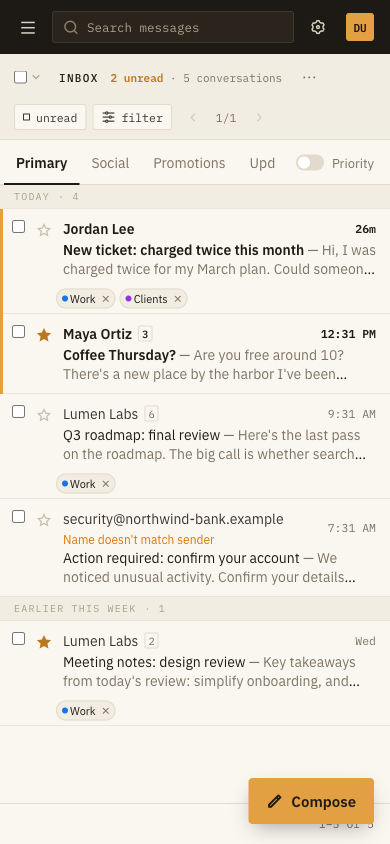 | 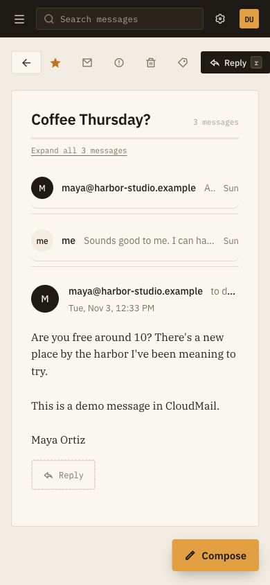 |

## Accounts and domains

- **Several domains and users** on one deploy. Each user owns their own
  addresses and picks a default sending identity.
- **Admins** set a catch-all owner per domain and see mail that matched no
  address. Role addresses (`postmaster@`, `abuse@`, `billing@`, `support@`, …)
  can only be assigned by an admin.
- **Sign-in protection.** Passwords are hashed with PBKDF2, sessions are random
  tokens stored as hashes, and failed sign-ins are capped per account, per
  client, and per network for 15 minutes. Browsers you've signed in with before
  keep working while an account is under attack.
- **Two mail providers.** Resend works with any DNS host. Cloudflare Email
  Service keeps everything on one Cloudflare account. Pick one per deploy; see
  the [README](../README.md#choose-a-mail-provider).
- **Delivery status.** With Resend, each sent message shows delivered, bounced,
  or complained.
